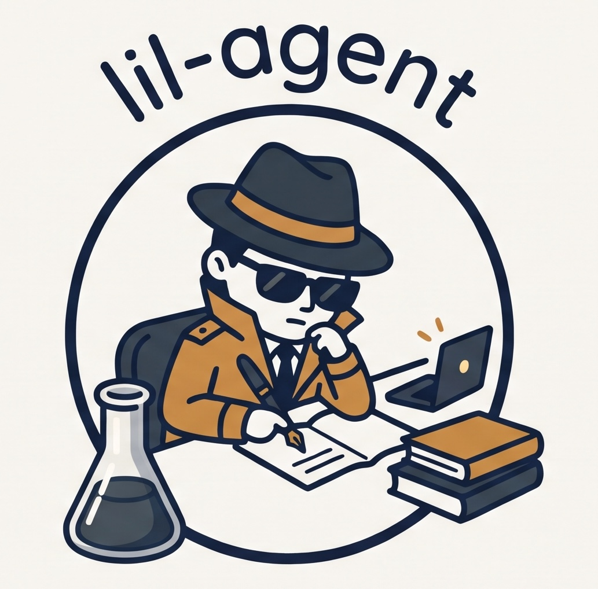

<p align="center">
  
</p>

# lil-agent

Give it a study package: a zip that carries everything the analysis needs,
meaning data, research question, instructions and skills. It unzips the
package and works through the instructions with an LBL-hosted open-weight
model. The default is GLM, as
`lbl/cborg-coder-max` on [CBorg](CBORG.md). The result is analysis
scripts, results tables, figures and a draft report.

```bash
lil-agent run ~/Downloads/<study>.zip
```

The agent is Claude Code, run headless, with its model swapped for the
CBorg one. Nothing is sent to Anthropic or Google. That is enforced, not
just configured; see below.

## Install

```bash
git clone https://github.com/biorack/lil-agent.git
ln -s "$PWD/lil-agent/bin/lil-agent" ~/.local/bin/lil-agent   # any directory on PATH
lil-agent check
```

You need:
- the [Claude Code](https://code.claude.com) CLI (`claude`), installed
  separately under its own terms;
- `python3` with pandas, numpy, scipy, statsmodels, scikit-learn,
  matplotlib and seaborn (the agent's analysis environment);
- a [CBorg](https://cborg.lbl.gov) API key, either in `$CBORG_API_KEY` or
  in a file named by `$CBORG_API_KEY_FILE` (default
  `~/secrets/cborg-api-key.txt`).

lil-agent itself uses only the Python standard library. It has been tested
on macOS (Apple silicon). Claude Code's sandbox also exists on Linux
(bubblewrap), but lil-agent hasn't been tried there.

## Study packages

lil-agent does one thing: run what's in the zip. The study-specific parts
(instructions, analysis guidance, helper code, reference tables) belong in
the package, so the same zip runs the same way in lil-agent, Claude Science
or any other harness, and is archived with the data it describes. To avoid
hand-copying shared guidance into every zip, keep skills in one versioned
place and copy them in when the package is built.

lil-agent finds every folder in the package that contains a `SKILL.md`
(Agent Skills format), copies it into the run's `.claude/skills/`, and
tells the agent to read those files before starting. Claude Code's own
built-in skills (charting, research and so on) are switched off, so only
the package's guidance applies.

A package needs:
- instructions the agent can find (e.g. `INSTRUCTIONS.md` or a README that
  points to them);
- the data;
- any skills and reference files the instructions rely on.

`examples/make_demo_study.py` builds one in this layout.

## Commands

| Command | |
|---|---|
| `lil-agent run STUDY.zip` | headless run; progress streams to the terminal |
| `  --skill DIR` | add a skill folder, or replace a bundled one with the same name (for trying a new version without rebuilding the zip) |
| `  --model M` | another CBorg model, e.g. `lbl/gemma-4` (or set `CBORG_MODEL`) |
| `  --interactive` | open a Claude Code session in the run folder instead; you approve each step |
| `  --timeout MIN`, `--max-turns N`, `--runs-dir DIR` | limits and location (default `~/lil_runs`) |
| `lil-agent resume RUN_DIR` | continue a stopped run where the agent left off (`--message` to tell it something, `--model` to switch models) |
| `lil-agent models [--all] [--probe NAMES]` | list LBL-hosted models with CBorg's label for each; test chat and tool calls |
| `lil-agent check` | key, CBorg access over IPv6/IPv4, model, `claude`, and the network guard |

## What a run produces

`~/lil_runs/<study>-<model>-<timestamp>/` contains:

```
<the unzipped package, untouched>
outputs/
  code/        analysis scripts, rerunnable in order
  results/     tables and JSON written by those scripts (report numbers come from here)
  figures/
  report.md    draft write-up
  notes.md     the agent's log of what it did and every judgment call
.lil/
  run.json         model, CBorg model entry, Claude Code version, skills, timings, exit status
  transcript.jsonl every message and tool call
  network.log      every connection Claude Code attempted, allowed or blocked
.claude/settings.json  the sandbox and permission settings used
.claude/skills/        the skills installed from the package (and --skill)
```

The run folder is a git repository. Its first commit is the package as
unzipped and its second is the agent's work, so `git diff HEAD~1 --stat`
shows everything it created.

## Where your data goes

| Path | Where it goes | How that's enforced |
|---|---|---|
| Claude Code's own traffic (prompts, file contents, results) | CBorg only | Claude Code is pointed at a local proxy that only connects to `api.cborg.lbl.gov` and logs every attempt (`.lil/network.log`). Nonessential traffic (telemetry, error reports, updates) is switched off. |
| The agent's shell commands (Python etc.) | nowhere | Claude Code's sandbox (macOS Seatbelt): no network; no reads of `~/secrets`, `~/.ssh`, `~/.aws`, `~/.config/gcloud` or `~/.claude`; no writes outside the run folder; the CBorg key is removed from their environment. |
| Web tools | — | WebFetch and WebSearch are disabled. |

Verified 2026-10-30 with a hostile self-test package. `curl` to Google
failed, reading the key file failed, the key was absent from the
environment, reading `~/.ssh` was denied, and writing to `~` was blocked.
An independent `lsof` sampling of every process lil-agent started found:
- Claude Code had no outside connections, only localhost sockets to the
  proxy;
- lil-agent's Python process connected only to CBorg.

Caveats for claims you make:

- **Cloudflare is in the path.** `api.cborg.lbl.gov` is served through
  Cloudflare's network (it resolves to `cdn.cloudflare.net`). Cloudflare is
  LBL's vendor, not Anthropic or Google, but traffic passes through its
  servers, and its proxy service normally decrypts at the edge. For a
  strictly LBL-only network path, ask Science IT whether CBorg has an
  internal endpoint.
- **The harness is closed source.** Claude Code is Anthropic's software,
  running locally. The proxy and sandbox are what back the claim, not the
  software's own promises. Swapping in an open-source harness (OpenCode,
  Codex CLI) would make "open model + open harness" claimable; only
  `lil_agent/run.py` would change.
- **What the proxy can and can't see.** The proxy only sees traffic that
  honors `HTTPS_PROXY`. The `lsof` check found no other connections from
  Claude Code, but it was a sampled check, not a firewall.
- **Other software on the computer** is outside lil-agent's control. For
  example, Claude Code sessions configured for Vertex were seen connecting
  to both Google and Anthropic addresses.
- **Local transcripts.** Claude Code keeps its own session transcripts
  under `~/.claude/projects/` on the local disk.

## Which model ran

CBorg changes the models behind its aliases often (`cborg-coder-max` was a
917k-context GLM deployment in October and is GLM 5.3 Flash now). At the
start of every run and resume, lil-agent prints which model it believes it
is using, and records it in `.lil/run.json` under `model_provenance`:
- CBorg's label for the model (e.g. "CBorg Coder Ultra - Mistral Large 4");
- the backend, context size and a hash of CBorg's entry;
- the model's own answer to "what are you?";
- the history in [cborg_models.json](cborg_models.json).

It warns when the label or context size no longer matches that record,
which is how a silent switch by CBorg shows up. Each resumed session is recorded
separately, so a model swapped between a run and its resume shows up. See
[CBORG.md](CBORG.md#which-model-is-behind-each-alias).

## When a model or CBorg is unavailable

Before creating a run folder (and before resuming), lil-agent checks that
the model is in CBorg's list and answers one short request. If it isn't
listed, lil-agent names similar models (for example `cborg-coder-ultra-medium`
for a mistyped `lbl/cborg-coder-ultra-medium`) and the default. If it's
listed but not answering, it says so and suggests what to try. If a model
disappears in the middle of a project, continue on another one with
`lil-agent resume RUN_DIR --model NAME`; each session's model is recorded.

CBorg's address is `https://api.cborg.lbl.gov` unless `CBORG_BASE_URL` is
set, and the network guard follows it. If CBorg can't be reached or
answers with something unexpected, lil-agent prints what went wrong and
what to check (network, VPN, `CBORG_BASE_URL`) instead of crashing. If only
CBorg's model list is unavailable, runs continue without the model check
and provenance.

## When a run stops

Every stop leaves `.lil/run.json` and the work so far, committed to the
run's git repo. The summary prints `lil-agent resume <run dir>`, which
continues the same agent session, conversation included.

- **CBorg timeouts.** CBorg sits behind Cloudflare, which gives up if the
  model takes more than 120 s to start replying (error 524), as can happen
  when CBorg is busy. lil-agent treats 429/5xx/52x errors as temporary: it
  waits 2, 4, then 6 minutes and resumes automatically, up to 3 times.
- **Memory.** The prompt states the machine's RAM and a per-process budget
  (a quarter of RAM), with rules for loading large tables. A script killed
  with "Killed: 9" ran out of memory; the agent is told to make it leaner.
- **"IP address … not recognized" (403).** Off LBLnet, CBorg only accepts
  addresses authorized at https://api.cborg.lbl.gov/key/manage. A laptop
  can have an authorized IPv6 address and an unauthorized IPv4 one.
  `lil-agent check` shows which work. lil-agent prefers IPv6, but authorize
  both (or use the VPN) to be safe.
- **Replies that are too long.** Each model has a per-reply output cap
  (32,768 tokens for GLM 5.3 Flash), and reasoning counts toward it. CBorg
  runs GLM at high reasoning effort and ignores Claude Code's thinking
  budget, so GLM can reason past the cap when it works through a search in
  its head. Claude Code then stops with "exceeded the … output token
  maximum". The prompt states the cap and says to put searches in scripts.
  If it happens anyway, lil-agent resumes the session at once and tells the
  agent to use code. Models with selectable reasoning effort (e.g.
  `cborg-coder-ultra-low` or `-medium`) are an alternative.
- **Chained shell commands.** Claude Code holds commands chained with `&&`,
  `;` or `|` for approval, which headless runs can't give. The agent is
  told to run one command per call and put multi-step work in scripts.

## Tested on

`python3 examples/make_demo_study.py /tmp/demo` builds a simulated study:
a soil bacterium under low phosphate or low nitrogen, 120 features, with
planted effects, noisy features and contaminants. The answers go in
`demo_truth.json` and are not included in the zip.

On 2026-10-30 there were two runs with GLM. In the second, the analysis
steps lived in a bundled skill. The runs took 3.9 min / 54 turns and 10.6 min / 106
turns; the second spent most of its extra turns polishing the report. Both
runs gave the same scientific result:
- found all 14 planted treatment effects, plus the same 3 false positives;
- flagged 4 of 4 blank contaminants and 5 of 6 noisy features;
- noticed that injection order was confounded with treatment and made that
  the report's main caveat.

## Layout

| Path | |
|---|---|
| [lil_agent/](lil_agent/) | the CLI: `run.py` (study runs), `proxy.py` (network guard), `cborg.py`, `cli.py` |
| [cborg/claude-cborg](cborg/claude-cborg) | Claude Code pointed at a CBorg model; usable on its own |
| [examples/make_demo_study.py](examples/make_demo_study.py) | synthetic study package for testing |
| [CBORG.md](CBORG.md) | which LBL-hosted models exist, how they compared, CBorg quirks |
| [cborg_models.json](cborg_models.json) | which model each CBorg backend ran, and when |
